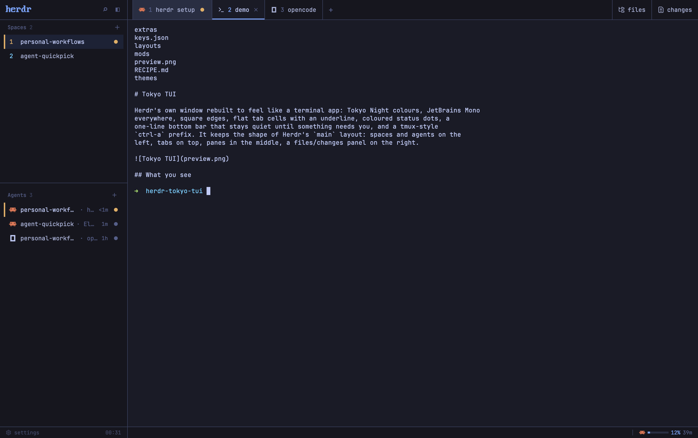

# Tokyo TUI

Herdr's own window rebuilt to feel like a terminal app: Tokyo Night colours, JetBrains Mono
everywhere, square edges, flat tab cells with an underline, coloured status dots, a
one-line bottom bar that stays quiet until something needs you, and a tmux-style
`ctrl-a` prefix. It keeps the shape of Herdr's `main` layout: spaces and agents on the
left, tabs on top, panes in the middle, a files/changes panel on the right.

## What you see

Left to right, top to bottom. Colours are theme names from `themes/tokyonight.json`
(`#1a1b26` background, `#16161e` chrome and canvas, `#3b4261` border, `#7aa2f7` accent,
`#565f89` dim, `#e0af68` working, `#f7768e` blocked, `#9ece6a` done). Every font is
JetBrains Mono except the wordmark.

- **Sidebar, 268px**, chrome background, 1px border dividers.
  - **Header, 42px:** `herdr` in the IBM VGA 8x16 pixel font (22px, accent) followed by a
    hard-blinking `█` cursor (530ms on/off). On the right, two dim glyph buttons:
    `⌕` (search: opens the space picker, `⌘P`) and `◧` (fold the sidebar, `⌘B`; `◨` when
    folded). Bottom border lines up with the tab bar's.
  - **Spaces, 40% of the lists** (weight 2): header `Spaces N` (11px dim, count in
    border colour) and a `+`. Rows 30px: the space's number in its own colour (from the
    theme's ansi colours), its name (an unnamed space in the home folder shows its
    folder's name instead of `~`), git details on the right, and a status dot. The
    shown space has a faint selected background and a 3px bar on the left in its colour;
    other spaces get a 3px bar in the status colour while an agent in them works, needs
    you, or is done. Worktree spaces nest under their repo with `└─`.
  - **Agents, 60%** (weight 3): header `Agents N` and a `+` that opens the
    start-an-agent menu. One flat list, most urgent first (needs you, done, working, idle);
    no group headings. Rows 30px: a 3px status bar on the left, the program's icon, the
    agent's name (app tags like `OC |` stripped), time since last change, status dot.
    The space name appears before the agent only when there is more than one space.
    Sub-agents nest with `├─` / `└─` text lines.
  - **Footer, 24px:** `⚙ settings` (12px gear, 11px text, dim at 70% opacity, brightens
    on hover) and the clock (`HH:MM`, same dim style) on the right.
- **Tab bar, 42px**, chrome background. Each tab is a flat full-height cell with a
  divider on its right: program icon, tab number (accent when shown), the tab's name only
  when someone named it, a `Z` when zoomed, a status dot, and `×` on the shown tab. The
  shown tab has the terminal background and a 2px accent underline. `+` sits right after
  the last tab. On the far right, `files` and `changes` cells (lowercase, Lucide
  folder-tree and file-diff icons); the open one gets the same underline.
- **Panes:** a tab with one pane shows the terminal edge to edge, no frame. Split panes
  get a 1px border (accent when focused), square corners, 4px gaps, and a 24px header:
  `─ ● name ──────── ⧉ ⊟ ⤢ ×`. The name is the agent's chat name, the tab's name when
  the tab is named after its agent, the program for an app (nvim, lazygit), or a dim
  `zsh` for a plain shell. The focused header is lighter (`popover`) with an accent title;
  the split/zoom/close buttons (10px icons) show only on the focused or hovered pane.
- **Files / changes panel, 368px**, hidden until opened. Each has a 24px header in the
  pane-header style (`─ ⧉ files ──── folder`, `─ ± changes [N] ──── +A −D`).
  Files: 22px rows, `▸`/`▾`, a `│` guide per level, real folders first, dotfiles and
  caches at 50% opacity. Changes: the filename in full then its folder dimmed, a 3px
  accent bar on the open file, a diff that scrolls sideways with a soft right edge, and
  a `❯ Commit message … [commit]` prompt row (green `[commit]` once there's a message).
- **Bottom bar, 24px**, chrome background, top border level with the sidebar footer's.
  Quiet things are icons, things that need you are words:
  - Left, only while agents need you: a red `● 3 need you` block, then up to three chips
    (program icon, program name, time waiting; longest first), `+N`, and `⌘] next`.
  - Right: threshold alerts in red words (`bat 14%` under 20% and discharging,
    `cpu 92%` over 85%, `mem 93%` over 90%); a running icon with a count (programs in
    this space's panes that aren't shells or agents, plus listening ports from inside
    this space's folders); a branch icon with a dot for PR checks (green passing, yellow
    running), which becomes words like `✗ #667 2 checks` when they fail; a divider; then
    Claude usage, always in words: Claude mark, 44px meter, percentage, time to reset
    (accent, yellow from 70%, red and bold from 90%).
  - Clicking running, branch or usage opens a small card (a popup) for just that section.

## How it behaves

- **Agent statuses** are dots everywhere (agents list, spaces, tabs, pane headers):
  working yellow, pulsing between 60% and 100% opacity; needs you red; done green;
  idle grey (agents list only). Rows also carry a 3px bar in the status colour.
- **`ctrl-a`** opens a small `C-a` badge at the top of the window; the next key acts:
  `h j k l` / arrows move between panes, `v` split right, `s` split down, `x` close
  pane, `z` zoom, `{ }` swap, `c` new tab, `n p` next/previous tab, `1`–`9` tab, `^`
  last tab, `,` rename tab, `&` close tab, `( )` previous/next space, `$` rename space,
  `Space` / `f` / `w` space picker, `:` command palette, `?` the full list (any key
  closes it), `ctrl-a` sends a real ctrl-a to the program. Esc or an unknown key cancels.
  The badge is accent while it has the keyboard and red `C-a ✕` if it doesn't (click it).
- **Bottom-bar cards:** running lists programs (click: go to the pane) and ports (click:
  open `http://localhost:<port>`); branch shows branch, ↑ ahead, `+/−`, and the PR (click:
  open on GitHub); usage shows the 5-hour and weekly windows with reset times.
- **Clicks:** chips in the bottom bar focus that agent; `⌕` opens the picker; tab
  right-click opens Herdr's tab menu; double-click a tab renames it; drag tabs to reorder.
- **Polling:** usage file every 20s, system every 30s, ports every 15s, git/PR every 60s.
  All animation is native (`.loop`, `.frames`, `.spin`); no redraw timers.

## Built from

- **Layout** `layouts/tokyo-tui.json`: the `main` layout's tree with the same ids
  (`root` row → `sidebar` column [`brand`, `sidebar-lists` column [`spaces`, `agents`],
  `sidebar-footer`] + `work` column [`tabs`, `work-body` row [`main` tab block, `panel`
  column → `panel-body` stack [`files`, `changes`]], `status`]). Root look:
  `theme: "tokyonight"`, `font` and `ui_font` JetBrains Mono, `font_size` 13,
  `titlebar: "none"`, `traffic_lights` [12, 16], `terminal_padding` [14, 12].
  `work-body` padding 0, gap 0; pane frame `lone: false`, `radius` 0, `gap` 4, header
  `tui-pane` 24px top, always.
- **Theme** `themes/tokyonight.json`: Tokyo Night (night) with panel colour overrides.
- **Mods**, each a copy of a shipped one (`mod.clone`) restyled, or new:
  `tui-workspace-chrome` (header and footer, `props.footer`), `tui-spaces`, `tui-agents`,
  `tui-tabs`, `tui-files`, `tui-changes` (clones); `tui-pane` (pane header), `tui-bar`
  (bottom bar and, with `props.card`, its cards), `tmux-prefix` (the `ctrl-a` badge and
  key list) are new. `state.js` (status dots) is copied into each mod that draws one.
- **Shipped mods it uses:** `picker`, `menu`, `new-menu`, and icons from `mods/pane/`
  and `mods/workspace-chrome/`.
- **Commands:** `pane.split/close/zoom/go/swap/focus`, `tab.new/next/prev/select/rename/
  close`, `space.next/prev/rename`, `agent.focus`, `mod.open`, `layout.toggle/resize/
  select/show/hide`, `app.palette`, `app.help`, `app.settings`.
- **Programs run:** `git` (spaces, files, changes, branch card), `gh pr view` (PR
  checks), `lsof` (listening ports), `pmset`, `ps`, `sysctl`, `memory_pressure` (system
  alerts), `hc send` (the prefix's `ctrl-a ctrl-a`), `open` (ports and PR links).
  Nothing reaches the network except `gh`.
- **Files read outside the mod folders:** `~/.config/herdr-app/data/claude-usage.json`.
- **Keys** `keys.json`: `ctrl-a` → `mod.open:tmux-prefix` in `global` and `terminal`.
- **Claude usage** comes from `extras/herdr-statusline.sh`, a Claude Code status-line
  command that copies the `rate_limits` object Claude Code passes it to
  `~/.config/herdr-app/data/claude-usage.json` (needs `jq`). It prints nothing, so Claude
  Code's screen is unchanged. Install: copy it to `~/.claude/`, `chmod +x`, and set
  `"statusLine": {"type": "command", "command": "~/.claude/herdr-statusline.sh"}` in
  `~/.claude/settings.json` (merge it with any status line you already have).
- **Art:** IBM VGA 8x16 font (`mods/tui-workspace-chrome/fonts/`, licence alongside);
  Lucide icons; the status-dot idea after Orca (stablyai/orca).

## Watch out

- **macOS only as built:** `pmset`, `memory_pressure` and `open` are macOS commands; on
  Linux the system alerts and port/PR links do nothing.
- **Claude usage** shows only for Claude Pro/Max subscribers, only after Claude Code's
  first reply in a session, and `—` before that. A window drops out once its reset
  time passes. Codex usage isn't shown (no equivalent hook).
- **Running count** ignores panes whose folder is the home folder, so stray servers on
  the Mac don't count as "yours". Jobs don't show failures: Herdr's terminal list has no
  exit codes.
- **The `ctrl-a` prefix takes ctrl-a from every program**: use `ctrl-a ctrl-a` to send it,
  or `⌘←` for start of line. The prefix is a popup that has to take the keyboard; Herdr's
  `keys.json` has no multi-key sequences.
- **`ctrl-a ^` (last tab)** is tracked by the sidebar footer, so it only works while the
  sidebar shows in this layout.
- **The wordmark font** loads at start or on a look change; after copying the files,
  switch layouts once (or restart) before it appears.
- **Clones don't update** with Herdr: improvements to the shipped spaces, agents, tabs,
  files or changes mods won't reach these copies.
- **Status dots** pulse with `.loop("opacity", { from: 0.6 })`; lower minimums make
  working yellow read as brown.

## Done when

- `herdr-app check` passes for every folder in `mods/`.
- `herdr-app do layout.switch --name tokyo-tui` shows the window above with no
  `layout.error`, and `herdr-app status` lists no errors.
- An agent that needs you shows a red dot in the agents list, a red bar on its space,
  and a `● 1 needs you` chip in the bottom bar that focuses it when clicked.
- A single-pane tab has no frame; splitting it (`ctrl-a v`) adds borders and headers,
  and the buttons appear only on the focused pane.
- `ctrl-a` shows the `C-a` badge in accent; `ctrl-a ?` shows the key list.
- After one Claude Code reply, the bottom bar shows `Claude ▰ N% Xm` matching `/usage`.
- In a repo with an open PR, the branch icon shows a dot; a failing check turns it into
  `✗ #N k checks`.
